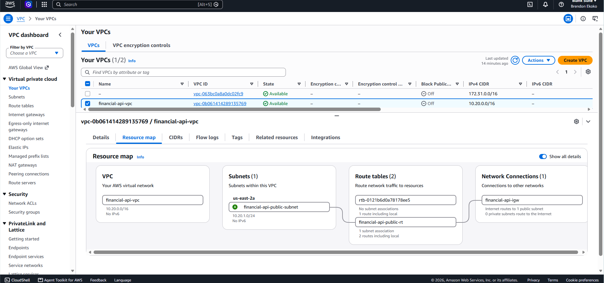
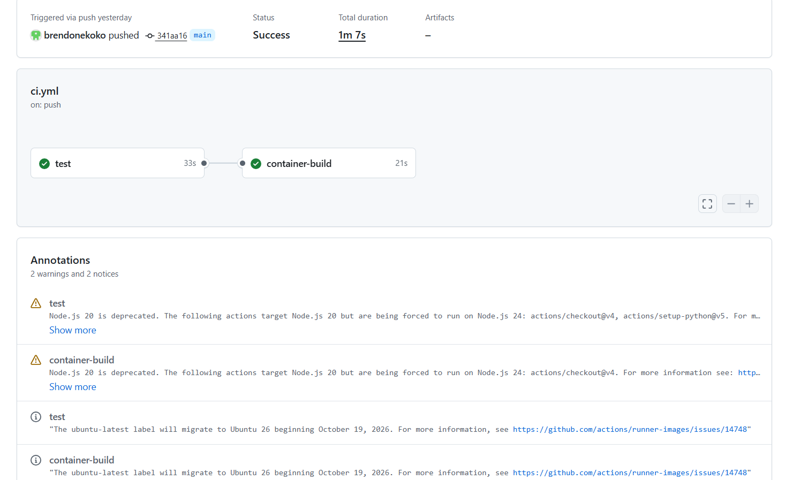
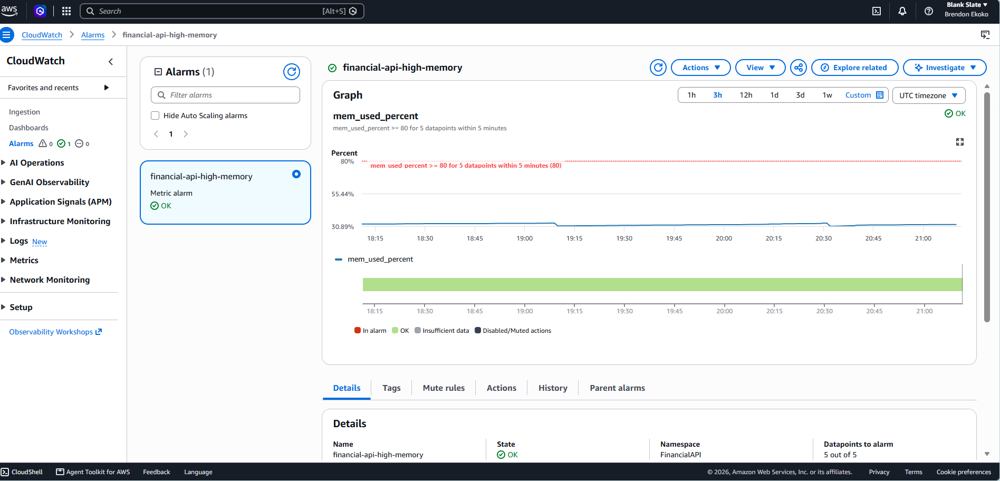
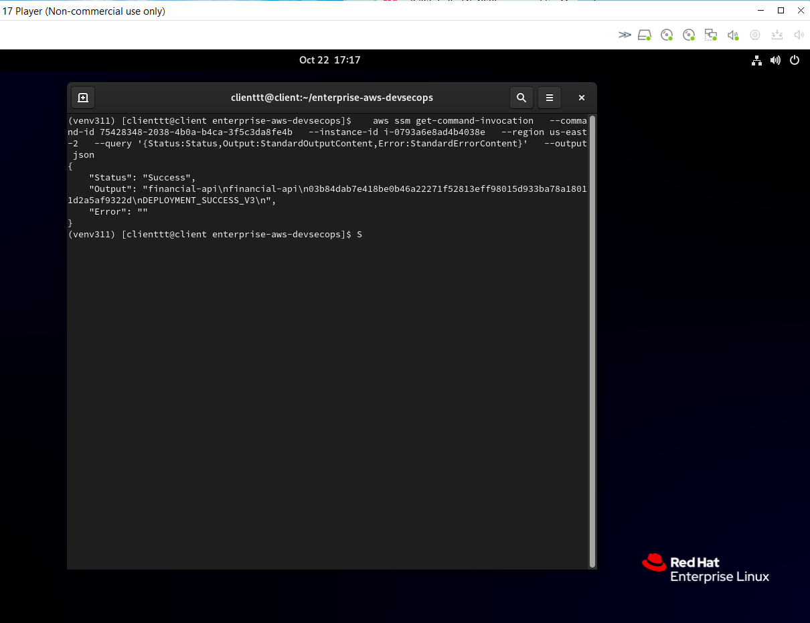
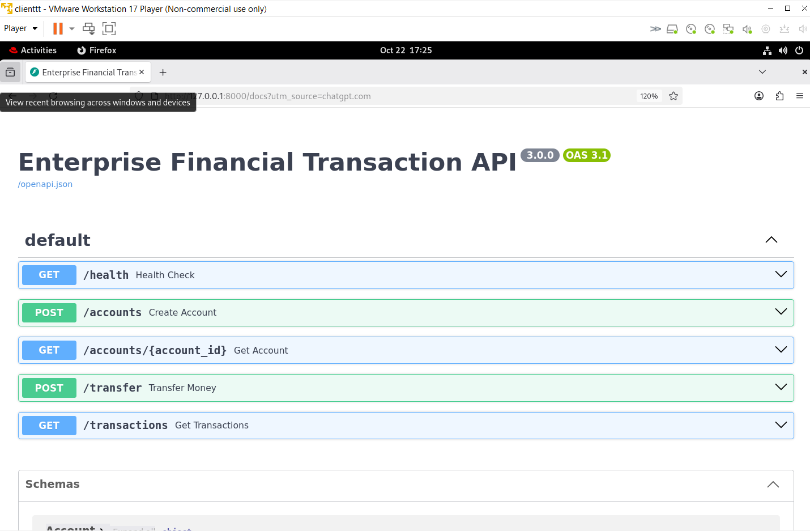

# Enterprise AWS DevSecOps Platform

## Project Overview
Built and deployed a containerized Financial Transaction Processing API on AWS to demonstrate cloud infrastructure engineering, automation, application deployment, and monitoring.

## Technologies Used
- AWS: EC2, VPC, IAM, S3, Systems Manager, CloudWatch
- Terraform for infrastructure provisioning
- Python and FastAPI for the REST API
- Docker and Podman for containerization
- GitHub Actions for continuous integration
- Linux, Bash, and pytest

## What I Accomplished
- Provisioned AWS cloud infrastructure using Terraform.
- Developed a financial API with account, transfer, transaction history, and health-check endpoints.
- Created a GitHub Actions workflow for automated testing, security auditing, and container builds.
- Configured CloudWatch monitoring, application logs, and memory alarms.
- Deployed version 3 of the application using AWS Systems Manager.
- Validated the new release with health checks and preserved version 2 for rollback.
- Resolved IAM permission and EC2 disk-space issues during deployment.

## Project Result
Successfully deployed Financial API v3 on AWS EC2 with monitoring, automated CI checks, and a deployment process with rollback logic. The project uses fictional, in-memory financial data and is intended as an engineering portfolio demonstration.
## Project Screenshots

### 1. AWS VPC Infrastructure

### 2. GitHub Actions CI Pipeline

### 3. CloudWatch Monitoring

### 4. AWS Deployment Success

### 5. Financial API Interface

